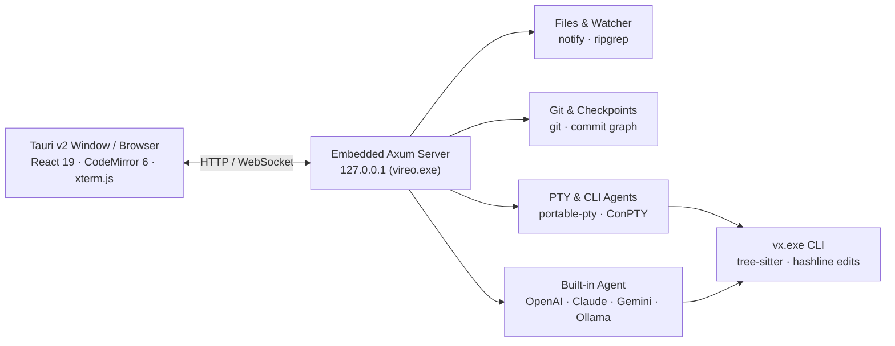

<div align="center">


# Vireo

### A lightweight code workbench built around coding agents.

Borrows the ergonomics of VS Code while skipping Electron and heavy language servers —<br />
native Tauri v2 + Rust backend, live diffs, persistent terminals, Git checkpoints, and both built-in and CLI coding agents.

[](https://github.com/Cosmos-0118/vireo/actions/workflows/ci.yml)
[](https://github.com/Cosmos-0118/vireo/releases/latest)
[](https://github.com/Cosmos-0118/vireo/releases)
[](LICENSE)


<br />

**[⬇️ Download](https://github.com/Cosmos-0118/vireo/releases/latest)** &nbsp;·&nbsp;
**[✨ Features](#features)** &nbsp;·&nbsp;
**[🏗️ Architecture](#architecture)** &nbsp;·&nbsp;
**[🛠️ Build](#build-from-source)** &nbsp;·&nbsp;
**[🐞 Report a bug](https://github.com/Cosmos-0118/vireo/issues/new/choose)**

</div>

---

## Why Vireo?

Working with coding agents means spending most of your time reviewing diffs, steering tool calls, running checks in a terminal, and rolling back turns that went sideways. Heavy IDEs get in the way; raw terminals hide the diff. Vireo puts the agent, the live diff, the editor, Git, and the terminal in one fast native window.

| | |
| :--- | :--- |
| ⚡ **Fast & lightweight** | Native Tauri v2 window backed by a single Rust binary (`vireo.exe`) with the React/Vite UI embedded inside — no Electron runtime overhead. |
| 🔀 **Live diff-first workflow** | Side-by-side and unified diffs with word-level highlights refresh automatically as files change on disk. Stage, unstage, discard, or send any diff/line to the agent in one click. |
| 🤖 **Built-in & CLI agents** | Use the built-in multi-provider Agent Chat (with per-turn Git checkpoints) or run external CLI agents (`claude`, `codex`, `gemini`, `agy`, `opencode`, `cursor`, `copilot`, `amp`, `qwen`, `aider`, `cline`, `kilo`) right beside your diff. |
| 🧰 **Token-lean `vx` code tools** | Ships the companion `vx` CLI alongside `vireo` so external CLI agents can inspect repo maps, outlines, anchored line ranges, symbol edits, and compressed compiler diagnostics without wasting context tokens. |

## Get started

**Windows 10 (build 19041 / version 2004) or later · x64.** Uses the built-in WebView2 runtime; no Electron or extra runtime installation is required. Git ([MinGit](https://github.com/git-for-windows/git), with Git Credential Manager), [ripgrep](https://github.com/BurntSushi/ripgrep) and the [GitHub CLI](https://cli.github.com/) ship inside the app (`tools\`), so nothing else needs installing; if you already have any of them on `PATH`, your installed copy is used instead. Only the external coding-agent CLIs you want to use (`claude`, `codex`, …) are installed separately.

| | Download | How to use it |
| :--- | :--- | :--- |
| 💿 | **Installer**<br /><sub>`Vireo-Setup-<version>.exe`</sub> | Download from [the latest release](https://github.com/Cosmos-0118/vireo/releases/latest). Installs per-user by default (no administrator prompt required; all-users install is also available), adds a Start Menu entry, and optionally adds `vireo` and `vx` to your `PATH`. |
| 🗂️ | **Portable**<br /><sub>`Vireo-<version>-win-x64.zip`</sub> | Extract the archive into a folder and run `vireo.exe`. Keep `vx.exe` and the `tools\` folder next to it so agent shells find them automatically on `PATH`. |

> [!TIP]
> Vireo binaries are unsigned, so Windows SmartScreen may show a warning on first launch. Every release ships `SHA256SUMS.txt` and a GitHub build provenance attestation — see [Download integrity](#download-integrity-and-verification) to verify your copy.

Once installed (with `PATH` enabled), open any repository from your terminal:

```powershell
# Open the current directory in the native desktop app
vireo .

# Open a specific repository
vireo --dir "C:\path\to\your\repo"

# Run in browser/server-only mode instead of the desktop window
vireo --dir "C:\path\to\your\repo" --server-only --port 4317
```

## Features

| Area | What you can do |
| :--- | :--- |
| **Live diff viewer** | Side-by-side and unified diffs with word-level highlights that refresh automatically via filesystem watching. Stage, unstage, or discard per file, and send selected hunks or lines directly to the agent. |
| **Code editor** | CodeMirror 6 with multi-language syntax highlighting, `Ctrl+S` to save, and instant switching between code and diff views. |
| **Agent Chat** | Built-in coding agent that reads, edits, searches, lists files, and runs commands. Supports OpenAI, OpenRouter, DeepSeek, Anthropic Claude, Google Gemini, Ollama, and OpenAI-compatible endpoints. Every turn creates a Git checkpoint for one-click undo/redo. |
| **CLI Agent panel** | First-class integration and embedded PTY runners (Windows ConPTY) for `claude`, `codex`, `gemini`, `agy` (Antigravity), `opencode`, `cursor-agent`, `copilot`, `amp`, `qwen`, `aider`, `cline`, and `kilo`, with permission prompts and unified tool activity views. |
| **`vx` code intelligence CLI** | Tree-sitter powered (`Rust`, `TypeScript`, `JavaScript`, `Python`, `Go`, `C#`, `Java`, `Kotlin`, `C`, `C++`, `Ruby`, `PHP`, `Bash`, `JSON`) token-lean CLI automatically placed on `PATH` for agents: `vx map`, `vx outline`, `vx view`, `vx edit` (hashline-anchored), `vx symbol`, `vx create`, `vx search`, `vx ast` (built-in ast-grep engine; an installed `ast-grep` CLI is used only for other languages), and `vx check`. |
| **Integrated terminal** | Multi-tab terminal powered by `xterm.js` (WebGL) and Rust `portable-pty`, with an instant switch to Ghostty (WASM). Shells stay alive when hidden or reloaded, project tasks (`package.json`, `Cargo.toml`, Python) are auto-detected, and output can be sent straight to the agent. |
| **Git & Commit Graph** | Stage, unstage, discard, stash, commit, push, pull, fetch, switch/create/delete branches, cherry-pick, revert, merge, tag, browse commit history & commit graph, publish to GitHub, and roll back agent checkpoints. |
| **Themes & Quick Open** | Six built-in themes (*VS Code Dark+*, *Tokyo Night*, *Catppuccin Mocha*, *One Dark Pro*, *GitHub Dark Dimmed*, *GitHub Light*) plus VS Code `.json` theme import. `Ctrl+P` opens files, themes, and tasks; `Ctrl+Shift+F` searches the workspace with ripgrep. |

## Architecture

Vireo compiles the React/Vite frontend into `frontend/dist` and embeds it directly into the `vireo` Rust binary via `rust-embed`. At runtime, `vireo` binds an Axum HTTP/WebSocket server on `127.0.0.1` and opens a native frameless Tauri v2 WebView pointing at it (or serves it to any browser with `--server-only`).



| Path | Responsibility |
| :--- | :--- |
| [`backend/`](backend/) | Rust + Tauri v2 app (`vireo`), embedded Axum API/WebSocket server, Git & checkpoint engine, agent/CLI runners, PTY manager, and `vx` code-intelligence CLI (`backend/src/bin/vx.rs`). |
| [`frontend/`](frontend/) | React 19 + TypeScript + Vite + Tailwind CSS v4 UI: diff viewer, CodeMirror 6 editor, commit graph, agent activity panel, terminal tabs, themes. |
| [`installer/`](installer/) | Inno Setup 6 installer definition (`Vireo.iss`), build script (`build.ps1`), and automated install/health/uninstall smoke test (`smoke-test.ps1`). |
| [`scripts/`](scripts/) | Release staging (`stage-release.ps1`), pinned bundled-tool manifest and SHA256-verified downloader (`bundled-tools.json`, `fetch-tools.ps1`), and checksum/README integrity updater (`update-release-integrity.ps1`). |
| [`.github/`](.github/) | CI, release, and CodeQL workflows, Dependabot config, and issue/PR templates. |

## Build from source

**Requirements:** Windows 10 (build 19041) or later (x64), [Visual Studio Build Tools](https://visualstudio.microsoft.com/visual-cpp-build-tools/) (*Desktop development with C++*), [Rust](https://rustup.rs/) (stable), [Node.js](https://nodejs.org/) 22+, and Git.

**Build and launch (recommended):**

```powershell
git clone https://github.com/Cosmos-0118/vireo.git
cd vireo

.\build-and-run.ps1 "C:\path\to\your\repo"
```

Optional flags: `-CleanAll` runs a full `cargo clean` first, and `-BuildOnly` builds without launching. `build-and-run.ps1` automatically locates the Visual Studio C++ toolchain via [`msvc-env.ps1`](msvc-env.ps1), so it works from a plain PowerShell window.

**Launch an existing build:**

```powershell
.\vireo.ps1 "C:\path\to\your\repo"
```

**Build, test, and run manually:**

```powershell
# Load MSVC toolchain into the current PowerShell session
. .\msvc-env.ps1; Enter-MsvcEnv

# 1. Install dependencies and build the frontend bundle
npm.cmd --prefix frontend ci
npm.cmd --prefix frontend run build

# 2. Run Rust unit tests (covers both vireo and vx)
cargo test --manifest-path backend/Cargo.toml --locked

# 3. Build and run the desktop app
cargo run --release --manifest-path backend/Cargo.toml -- --dir "C:\path\to\your\repo"
```

Add `--server-only --port 4317` to use Vireo in a browser at `http://127.0.0.1:4317`.

Development builds use the Git/ripgrep/GitHub CLI already on your `PATH`. To exercise the bundled copies instead, stage them next to the binary (downloads are pinned and SHA256-verified, and cached in `artifacts/tools-cache`):

```powershell
pwsh scripts/fetch-tools.ps1 -Output backend/target/release
```

<details>
<summary><b>Build the Windows installer and portable package locally</b></summary>

<br />

Install [Inno Setup 6](https://jrsoftware.org/isinfo.php) (CI pins `6.7.1`), build the frontend and Rust release binaries (`cargo build --release --bins --manifest-path backend/Cargo.toml --locked`), then stage and package (staging also downloads and verifies the bundled tools listed in [`scripts/bundled-tools.json`](scripts/bundled-tools.json)):

```powershell
pwsh scripts/stage-release.ps1 -Output artifacts/publish
pwsh installer/build.ps1 -Version 0.2.0 -PublishDir artifacts/publish -OutDir artifacts
pwsh installer/smoke-test.ps1 -Setup artifacts/Vireo-Setup-0.2.0.exe
```

Pushing a version tag such as `v0.2.0` triggers [`.github/workflows/release.yml`](.github/workflows/release.yml), which runs all tests, builds the portable ZIP and Inno Setup installer, smoke-tests the installer, generates `SHA256SUMS.txt` and GitHub build provenance attestations, and publishes the GitHub Release.

</details>

## Download integrity and verification

<details>
<summary>Verify your download and why Windows SmartScreen may warn</summary>

<br />

Vireo is an open-source project and its Windows binaries are currently **unsigned**, so Windows SmartScreen or an antivirus may show an unrecognized-publisher warning. Every official release is built in GitHub Actions directly from the tagged commit, ships a `SHA256SUMS.txt` manifest, and carries a GitHub build provenance attestation.

<!-- This block is updated automatically by the release workflow (scripts/update-release-integrity.ps1). Do not edit it by hand. -->
<!-- release-integrity:start -->
- **Latest release:** [Vireo 0.3.0](https://github.com/Cosmos-0118/vireo/releases/tag/v0.3.0)
- **SHA256 checksums:**

  | File | SHA256 |
  | --- | --- |
  | `Vireo-0.3.0-win-x64.zip` | `8978d7b916ee8bb51e6d5f5f2466375fff435fa026807a7ac5383f756f0092f3` |
  | `Vireo-Setup-0.3.0.exe` | `e7d0dc5a89fe382165d51d546abe7732e75b597a3d749129bbf4d53b4d3a719d` |

  The same values are published as `SHA256SUMS.txt` on the release page.

- **Verify locally** (run in the folder you downloaded to):

  ```powershell
  (Get-FileHash .\Vireo-Setup-0.3.0.exe -Algorithm SHA256).Hash -eq 'e7d0dc5a89fe382165d51d546abe7732e75b597a3d749129bbf4d53b4d3a719d'
  ```

- **Verify build provenance** (with [GitHub CLI](https://cli.github.com/)):

  ```powershell
  gh attestation verify Vireo-Setup-0.3.0.exe --repo Cosmos-0118/vireo
  ```
<!-- release-integrity:end -->

</details>

## Contributing

Bug reports, ideas, and pull requests are welcome. See [`CONTRIBUTING.md`](CONTRIBUTING.md) for the development setup, test commands, and pull request checklist.

Please follow the [Code of Conduct](CODE_OF_CONDUCT.md). Report security issues privately as described in [SECURITY.md](SECURITY.md) rather than opening a public issue.

## License

Vireo is released under the **[MIT License](LICENSE)**.
