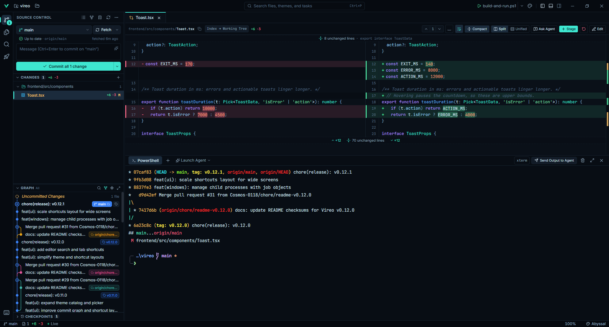
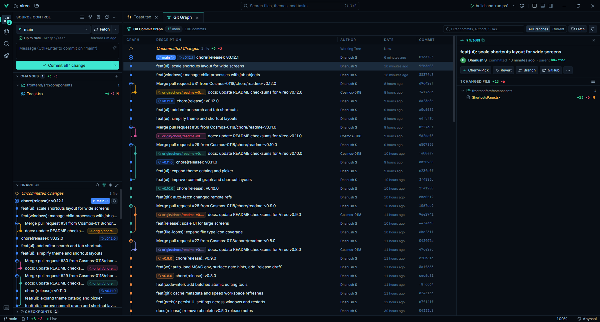
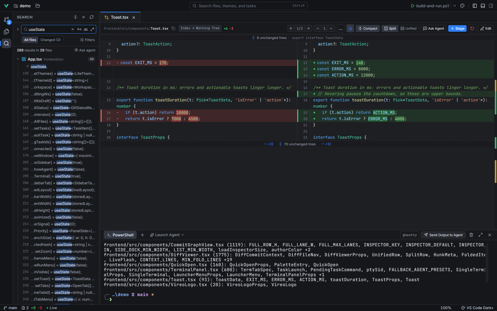
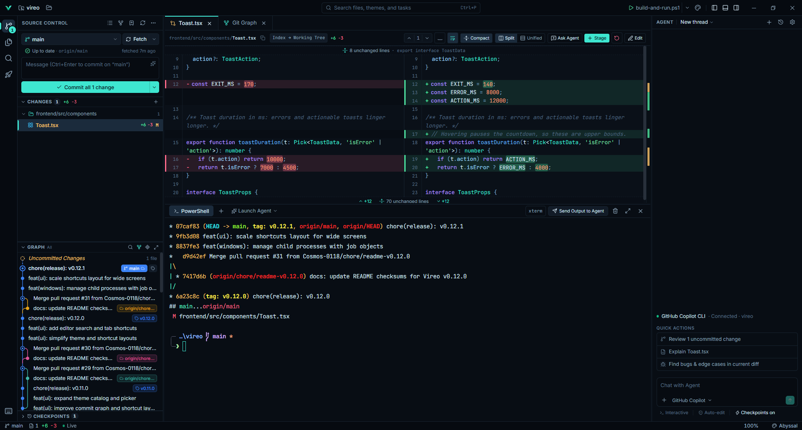
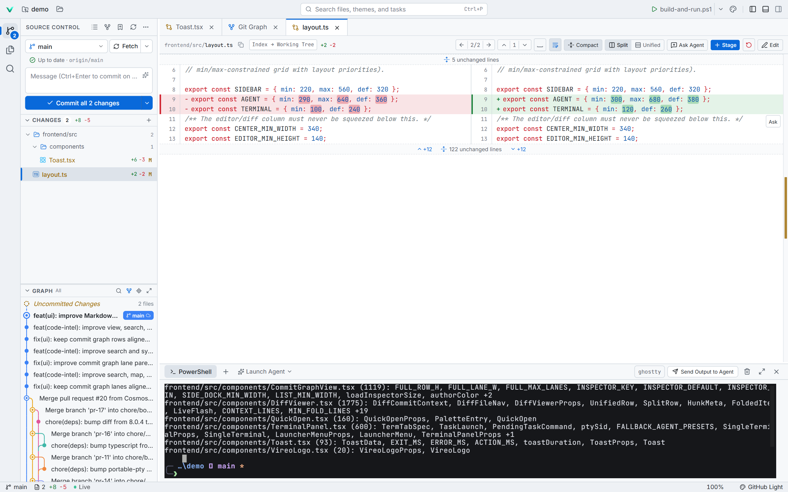
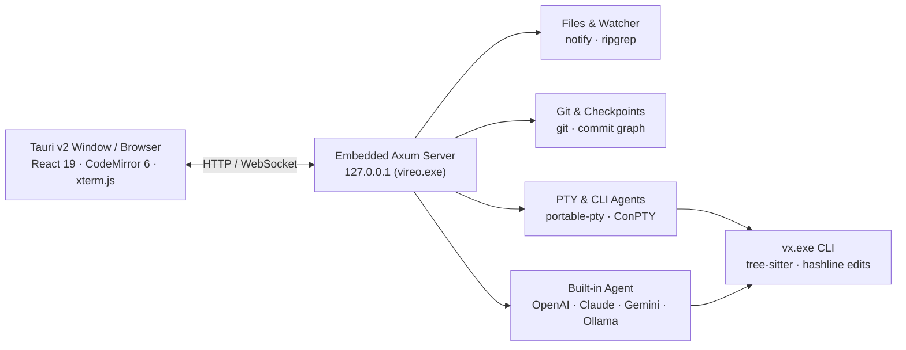

<div align="center">


# Vireo

### A lightweight code workbench built around coding agents.

Borrows the ergonomics of VS Code while skipping Electron and heavy language servers —<br />
native Tauri v2 + Rust backend, live diffs, persistent terminals, Git checkpoints, and both built-in and CLI coding agents.

[](https://github.com/Cosmos-0118/vireo/actions/workflows/ci.yml)
[](https://github.com/Cosmos-0118/vireo/releases/latest)
[](https://github.com/Cosmos-0118/vireo/releases)
[](LICENSE)


<br />

**[⬇️ Download](https://github.com/Cosmos-0118/vireo/releases/latest)** &nbsp;·&nbsp;
**[🖼️ Screenshots](#screenshots)** &nbsp;·&nbsp;
**[✨ Features](#features)** &nbsp;·&nbsp;
**[🏗️ Architecture](#architecture)** &nbsp;·&nbsp;
**[🛠️ Build](#build-from-source)** &nbsp;·&nbsp;
**[🐞 Report a bug](https://github.com/Cosmos-0118/vireo/issues/new/choose)**

</div>


---

<div align="center">
  
</div>

## Why Vireo?

Working with coding agents means reviewing diffs, steering tool calls, running checks, and rolling back turns that went sideways. Heavy IDEs get in the way; raw terminals hide the diff. Vireo puts the agent, the live diff, the editor, Git, and the terminal in one fast native window.

- ⚡ **Light and native.** Tauri v2 and a single Rust binary with the React UI embedded. No Electron, no language-server farm.
- 🔀 **Diff-first.** Diffs refresh as files change on disk. Stage, discard, or send any hunk or line to the agent in a click.
- 🤖 **Bring any agent.** A built-in multi-provider chat with per-turn Git checkpoints, or 12 CLI agents running right beside your diff.
- 🧰 **Token-lean code tools.** The bundled `vx` CLI gives agents repo maps, anchored edits, and compressed compiler errors.

## Screenshots

<table>
  <tr>
    <td width="50%"><br /><sub><b>Commit graph</b>: browse history, branches, and uncommitted work in one lane view.</sub></td>
    <td width="50%"><br /><sub><b>Workspace search</b>: ripgrep-powered, with results grouped by file.</sub></td>
  </tr>
  <tr>
    <td width="50%"><br /><sub><b>Agent panel</b>: chat or run a CLI agent next to the diff and terminal.</sub></td>
    <td width="50%"><br /><sub><b>Themes</b>: 22 built-in dark and light themes, plus VS Code <code>.json</code> import.</sub></td>
  </tr>
</table>

## Features

### Review and edit

- **Live diff viewer.** Side-by-side or unified, with word-level highlights and filesystem watching. Stage, unstage, or discard per file, and send selected hunks or lines to the agent.
- **Code editor.** CodeMirror 6 with multi-language highlighting, `Ctrl+S` to save, and instant switching between code and diff.
- **Quick Open and search.** `Ctrl+P` opens files, themes, and tasks. `Ctrl+Shift+F` searches the workspace with ripgrep.
- **Themes.** *VS Code Dark+*, *Tokyo Night*, *Catppuccin Mocha*, *One Dark Pro*, *GitHub Dark Dimmed*, *GitHub Light*, and VS Code theme import.

### Agents

- **Agent Chat.** A built-in agent that reads, edits, searches, and runs commands. Works with OpenAI, OpenRouter, DeepSeek, Anthropic Claude, Google Gemini, Ollama, and OpenAI-compatible endpoints. Every turn creates a Git checkpoint for one-click undo and redo.
- **CLI agents.** Embedded ConPTY runners for `claude`, `codex`, `gemini`, `agy` (Antigravity), `opencode`, `cursor-agent`, `copilot`, `amp`, `qwen`, `aider`, `cline`, and `kilo`, with permission prompts and a unified tool-activity view.

### Git and terminal

- **Git and commit graph.** Stage, commit, stash, push, pull, fetch, branch, cherry-pick, revert, merge, tag, and publish to GitHub. Browse history in the commit graph, and roll back agent checkpoints.
- **Integrated terminal.** Multi-tab `xterm.js` (WebGL) on Rust `portable-pty`, with an instant switch to Ghostty (WASM). Shells survive hiding and reloads, project tasks are auto-detected, and output can go straight to the agent.

### `vx` code intelligence

`vx` is a tree-sitter powered, token-lean CLI placed on `PATH` for agents. It covers Rust, TypeScript, JavaScript, Python, Go, C#, Java, Kotlin, C, C++, Ruby, PHP, Bash, and JSON.

| Command | What it does |
| :--- | :--- |
| `vx map` | Ranked file and symbol map of the repo |
| `vx outline` / `vx view` | Symbol outlines and anchored line ranges |
| `vx edit` / `vx symbol` | Hashline-anchored edits and whole-symbol replacement |
| `vx create` | Create new files |
| `vx search` | Search with ripgrep |
| `vx ast` | Structural search and rewrite (built-in ast-grep engine; an installed `ast-grep` is used only for other languages) |
| `vx check` | Run cargo, tsc, go, or any command with compressed diagnostics |
| `vx release` | Polyglot release engine (also the **Releases** sidebar pane): `status`, `preflight`, `notes`, `bump`, `publish`, `verify`. Syncs versions across Cargo, npm, Tauri, .NET, Python, Maven/Gradle, Go and installer files, builds Conventional-Commit notes, gates on a clean/synced tree and a free tag, then tags and pushes (tag-triggered CI) or creates a draft GitHub release. Always preview with `vx release publish --dry-run`. Extra version files, assets and checks go in `.vireo/release.json`. |

## Get started

**Windows 10 (build 19041 / 2004) or later, x64.** Vireo uses the built-in WebView2 runtime. Git ([MinGit](https://github.com/git-for-windows/git) with Git Credential Manager), [ripgrep](https://github.com/BurntSushi/ripgrep), and the [GitHub CLI](https://cli.github.com/) ship inside the app (`tools\`), so nothing else needs installing. If you already have any of them on `PATH`, your copy is used. Only the CLI agents you want to run (`claude`, `codex`, …) are installed separately.

| | Download | How to use it |
| :--- | :--- | :--- |
| 💿 | **Installer**<br /><sub>`Vireo-Setup-<version>.exe`</sub> | Get it from [the latest release](https://github.com/Cosmos-0118/vireo/releases/latest). Installs per-user by default (no admin prompt; all-users is available), adds a Start Menu entry, and can add `vireo` and `vx` to your `PATH`. |
| 🗂️ | **Portable**<br /><sub>`Vireo-<version>-win-x64.zip`</sub> | Extract and run `vireo.exe`. Keep `vx.exe` and `tools\` next to it so agent shells find them on `PATH`. |

> [!TIP]
> Vireo binaries are unsigned, so Windows SmartScreen may warn on first launch. Every release ships `SHA256SUMS.txt` and a build provenance attestation. See [Download integrity](#download-integrity-and-verification) to verify your copy.

With `PATH` enabled, open any repository from a terminal:

```powershell
vireo .                                   # open the current directory
vireo --dir "C:\path\to\your\repo"        # open a specific repository
vireo --dir "C:\path\to\your\repo" --server-only --port 4317   # browser mode at http://127.0.0.1:4317
```

## Architecture

The React/Vite frontend is compiled into `frontend/dist` and embedded in the `vireo` Rust binary via `rust-embed`. At runtime `vireo` binds an Axum HTTP/WebSocket server on `127.0.0.1` and opens a frameless Tauri v2 WebView pointing at it, or serves it to any browser with `--server-only`.



| Path | Responsibility |
| :--- | :--- |
| [`backend/`](backend/) | Rust + Tauri v2 app (`vireo`), Axum API/WebSocket server, Git and checkpoint engine, agent/CLI runners, PTY manager, and the `vx` CLI (`backend/src/bin/vx.rs`). |
| [`frontend/`](frontend/) | React 19, TypeScript, Vite, and Tailwind CSS v4 UI: diff viewer, CodeMirror 6 editor, commit graph, agent panel, terminal tabs, themes. |
| [`installer/`](installer/) | Inno Setup 6 installer (`Vireo.iss`), build script, and install/health/uninstall smoke test. |
| [`scripts/`](scripts/) | Release staging, the pinned bundled-tool manifest with its SHA256-verified downloader, and the checksum/README integrity updater. |
| [`.github/`](.github/) | CI, release, and CodeQL workflows, Dependabot config, and issue/PR templates. |

## Build from source

**Requirements:** Windows 10 (build 19041) or later x64, [Visual Studio Build Tools](https://visualstudio.microsoft.com/visual-cpp-build-tools/) (*Desktop development with C++*), [Rust](https://rustup.rs/) stable, [Node.js](https://nodejs.org/) 22+, and Git.

```powershell
git clone https://github.com/Cosmos-0118/vireo.git
cd vireo

.\build-and-run.ps1 "C:\path\to\your\repo"   # build and launch
.\vireo.ps1 "C:\path\to\your\repo"           # launch an existing build
```

`build-and-run.ps1` finds the Visual Studio C++ toolchain through [`msvc-env.ps1`](msvc-env.ps1), so it works from a plain PowerShell window. Pass `-CleanAll` for a full `cargo clean`, or `-BuildOnly` to skip launching.

<details>
<summary><b>Build, test, and run manually</b></summary>

<br />

```powershell
# Load the MSVC toolchain into this PowerShell session
. .\msvc-env.ps1; Enter-MsvcEnv

# 1. Install dependencies and build the frontend bundle
npm.cmd --prefix frontend ci
npm.cmd --prefix frontend run build

# 2. Run Rust unit tests (covers both vireo and vx)
cargo test --manifest-path backend/Cargo.toml --locked

# 3. Build and run the desktop app
cargo run --release --manifest-path backend/Cargo.toml -- --dir "C:\path\to\your\repo"
```

Add `--server-only --port 4317` to use Vireo in a browser at `http://127.0.0.1:4317`.

Development builds use the Git, ripgrep, and GitHub CLI already on your `PATH`. To exercise the bundled copies, stage them next to the binary (downloads are pinned, SHA256-verified, and cached in `artifacts/tools-cache`):

```powershell
pwsh scripts/fetch-tools.ps1 -Output backend/target/release
```

</details>

<details>
<summary><b>Build the Windows installer and portable package</b></summary>

<br />

Install [Inno Setup 6](https://jrsoftware.org/isinfo.php) (CI pins `6.7.1`), build the frontend and the Rust release binaries (`cargo build --release --bins --manifest-path backend/Cargo.toml --locked`), then stage and package. Staging also downloads and verifies the bundled tools listed in [`scripts/bundled-tools.json`](scripts/bundled-tools.json).

```powershell
pwsh scripts/stage-release.ps1 -Output artifacts/publish
pwsh installer/build.ps1 -Version 0.2.0 -PublishDir artifacts/publish -OutDir artifacts
pwsh installer/smoke-test.ps1 -Setup artifacts/Vireo-Setup-0.2.0.exe
```

Pushing a version tag such as `v0.2.0` triggers [`release.yml`](.github/workflows/release.yml). It runs all tests, builds the portable ZIP and installer, smoke-tests the installer, generates `SHA256SUMS.txt` and provenance attestations, and publishes the GitHub Release.

</details>

## Download integrity and verification

<details>
<summary>Verify your download and why Windows SmartScreen may warn</summary>

<br />

Vireo is an open-source project and its Windows binaries are currently **unsigned**, so Windows SmartScreen or an antivirus may show an unrecognized-publisher warning. Every official release is built in GitHub Actions directly from the tagged commit, ships a `SHA256SUMS.txt` manifest, and carries a GitHub build provenance attestation.

<!-- This block is updated automatically by the release workflow (scripts/update-release-integrity.ps1). Do not edit it by hand. -->
<!-- release-integrity:start -->
- **Latest release:** [Vireo 0.14.0](https://github.com/Cosmos-0118/vireo/releases/tag/v0.14.0)
- **SHA256 checksums:**

  | File | SHA256 |
  | --- | --- |
  | `Vireo-0.14.0-win-x64.zip` | `db349cf4827d30b971c8604b005a1e52e0359596c125cda62a98e00661f047ec` |
  | `Vireo-Setup-0.14.0.exe` | `8569f686aff37628f24d1a67de83b89abd179bf754d83a4200493125a16f444e` |

  The same values are published as `SHA256SUMS.txt` on the release page.

- **Verify locally** (run in the folder you downloaded to):

  ```powershell
  (Get-FileHash .\Vireo-Setup-0.14.0.exe -Algorithm SHA256).Hash -eq '8569f686aff37628f24d1a67de83b89abd179bf754d83a4200493125a16f444e'
  ```

- **Verify build provenance** (with [GitHub CLI](https://cli.github.com/)):

  ```powershell
  gh attestation verify Vireo-Setup-0.14.0.exe --repo Cosmos-0118/vireo
  ```
<!-- release-integrity:end -->

</details>

## Contributing

Bug reports, ideas, and pull requests are welcome. See [`CONTRIBUTING.md`](CONTRIBUTING.md) for the development setup, test commands, and pull request checklist.

Please follow the [Code of Conduct](CODE_OF_CONDUCT.md). Report security issues privately as described in [SECURITY.md](SECURITY.md) rather than opening a public issue.

## License

Vireo is released under the **[MIT License](LICENSE)**.
